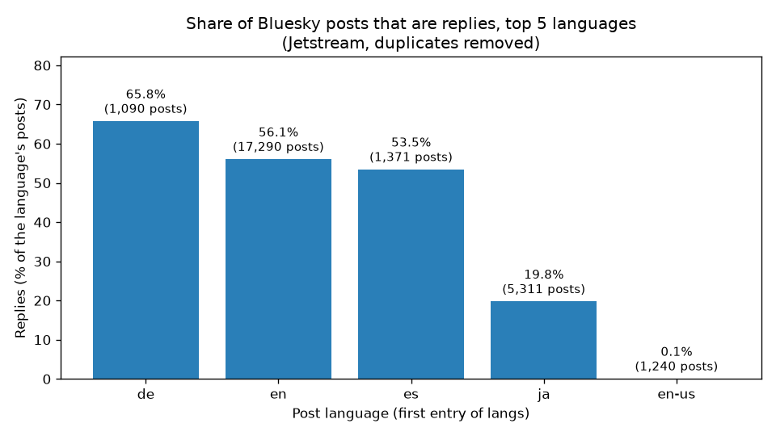

# Bluesky in Real Time: Which Languages Reply the Most?

**Author:** Lanvy Phan
**DS 3022 Data Project 3, Fall 2026**

## Data source

I stream Bluesky posts from **Jetstream**, a public WebSocket (push) that sends the Bluesky firehose as JSON:
`wss://jetstream2.us-east.bsky.network/subscribe?wantedCollections=app.bsky.feed.post`

- No account or API key needed (I send a User-Agent anyway).
- `wantedCollections` filters to posts only, so no likes or follows.
- I stream live. Jetstream can also replay a short window with `?cursor=<time_us>`, which I used for card D5.

One message = one event from one account: `did` (account id), `time_us` (when Jetstream got it), `kind`, and `commit` with `operation` (create/delete), `rkey` (post id) and, for new posts, `record` (`text`, `langs`, `createdAt`, and `reply` if it's a reply). My probe measured **45.1 messages/s**.

## How to run

Run every project command from the project3 folder (cd project3), or the flow finds no files

From a fresh clone, on macOS / Linux:

```bash
# 1. Venv + packages (in ds3022-streaming)
python3 -m venv .venv
source .venv/bin/activate
pip install -r requirements.txt
pip install prefect matplotlib

# 2. Start the 3-broker cluster (never -v, it deletes the topics)
docker compose up -d
docker exec -it redpanda-0 rpk cluster info

# 3. Create the topic BEFORE the producer
docker exec -it redpanda-0 rpk topic create bluesky_posts -p 3 -r 3

# 4. Terminal 1: producer (Ctrl+C to stop)
cd project3
python producer.py

# 5. Terminal 2: lander (writes data/raw/)
cd project3
python lander.py

# 6. Terminal 3: quick count of the raw files
cd project3
python four_numbers.py did,rkey

# 7. Flow on the full data and on the sample
python flow.py
python flow.py data/sample      # runs without Kafka, on the committed sample
```

Optional: `prefect server start` in a 4th terminal for the dashboard at http://127.0.0.1:4200.

## Architecture

```
Jetstream WebSocket (posts only, ~45/s)
        │
        ▼
producer.py   envelope {"action": "live", "data": <event>}, key = did
        │
        ▼
Kafka topic bluesky_posts   (3 partitions, replication factor 3)
        │   consumer group bluesky_posts_lander
        ▼
lander.py     1,000 records or 60 s per file, .tmp then rename, offsets after the file
        │
        ▼
data/raw/bluesky_<time>_<id>.parquet
        │
        ▼
flow.py (Prefect + DuckDB, bluesky.duckdb)
   load_raw  → raw_posts               every raw row
   stage     → stg_records             one row per Kafka record, malformed removed
   entities  → posts                   one row per post (did + rkey), creates only
   marts     → top_languages, mart_reply_share_10min, mart_reply_share
   charts    → charts/reply_share_by_language.png
```

Screenshots in `docs/`: `topic.png` + `partitions.txt` (3 partitions), `flow_log.png` (2 runs, same numbers), `prefect_dashboard.png` (the 5 tasks).

## Design decisions

1. **Key and partitions.** My key is `did` (the account). All events from one account go to the same partition in order, so a post's create always comes before its delete. It wasn't perfectly balanced though: my first run gave 1,758 / 1,973 / 4,529, because a few really busy bot accounts land on the same partition. Keying by `lang` would be way worse, since most posts are English and almost everything would end up on one partition.

2. **Batch size and time.** A file closes at 1,000 records or after 60 s. At ~45 messages/s, 1,000 records take about 22 s, so the **size rule closes almost every batch**. The 60 s rule only closes the last small batch when the producer stops (my first run: 8 files of 1,000, then one of 260). That's about 162 files per hour when streaming live.

3. **Offsets after the file.** The lander stores offsets only after the file exists. If it crashes in between (card D1), Kafka thinks those records weren't read, so the lander reads them again and writes a second copy. My raw went from 8,260 to 11,943 for 2,683 new records, because the crashed batch of 1,000 was landed twice. I'm fine with that (at-least-once), because a duplicate can be removed later, but if offsets were stored first, a crash could lose 1,000 records for good.

4. **Duplicates.** Same **Kafka record** = same `kafka_partition` + `kafka_offset` (from the D1 crash). The `stage` task removes these with `SELECT DISTINCT` (without `landed_at`, the only column that changes between two landings). Same **post** = same `did` + `rkey`, even with a different offset (from a replay: in D5, 26,956 posts came twice). The `entities` task keeps one row per post with `row_number() OVER (PARTITION BY did, rkey ORDER BY kafka_offset)` and `rn = 1`, and only `create` events. Result: 74,842 raw → 73,841 Kafka records → 35,697 posts.

5. **Windows and time.** I use `time_us` (event time, when Jetstream got the post), not `landed_at`. Landing time is wrong for replays: my D5 replay landed 10 minutes of posts in about 3 seconds. I don't use `createdAt` either, because the user's app sets it and it can be wrong. I use 10-minute windows (`time_bucket`). That's about 27,000 events per window, enough for a stable share per language, and my data covers 4 windows.

6. **Ten times the volume.** At ~450 messages/s, Kafka would be fine, but the lander would close a file every 2 s (about 1,600 small files an hour), and one Python process might fall behind. The flow would also get slow reading thousands of small files. I'd make batches bigger (like 10,000), run 3 landers in the same consumer group (one per partition), and merge old raw files into bigger ones.

## Chaos round

| Card | Prediction | What I did | Numbers before → after | Explanation |
|---|---|---|---|---|
| D1 Crash between file and offsets | raw goes up by the new records + 1,000 extra; unique Kafka records only by the new records | Stopped the lander, ran `producer.py` for 2,683 messages, ran `python lander.py crash`, then `python lander.py` | raw 8,260 → 11,943; malformed 0 → 0; unique records 8,260 → 10,943; unique did+rkey 8,142 → 10,744 | It crashed after writing the file but before storing offsets, so the restarted lander read the same 1,000 records again (at-least-once). Same partition + offset, so DISTINCT in the flow removes the copy. |
| D2 Poison message | raw +1, malformed +1, lander keeps running, the rest stays the same | `docker exec -it redpanda-0 rpk topic produce bluesky_posts -k bad`, typed `this is not JSON`, waited for the next Landed line, counted | raw 11,943 → 11,944; malformed 0 → 1; unique records 10,943 → 10,943; unique did+rkey 10,744 → 10,744 | `to_row()` caught the JSON error and landed it as `malformed` (land everything, decide later). The lander didn't crash, so the partition didn't get stuck on a message it would read again after every restart. |
| D5 Send it again | raw and unique Kafka records go up, but unique did+rkey goes up much less, since resent posts are the same posts | Took max(`time_us`) minus 2 min (cursor `1794489977064640`) and ran `python producer.py 1794489977064640`. I accidentally ran it twice in two terminals (30,622 + 32,276 messages), so the same 10 minutes got sent twice. Waited 60 s, counted | raw 11,944 → 74,842; malformed 1 → 1; unique records 10,943 → 73,841; unique did+rkey 10,744 → 39,517 | Resent posts become new Kafka records with new offsets, so DISTINCT on partition + offset can't catch them, but they're the same post (same did + rkey). 26,956 posts came exactly twice. The flow keeps one row per did + rkey. I found the double run because raw grew by 62,898 = 30,622 + 32,276. |

## The four numbers

From the flow log (screenshot in `docs/flow_log.png`):

| Number | Full data | Sample (`data/sample`) |
|---|---:|---:|
| Raw records landed | 74,842 | 5,000 |
| Malformed (kept in raw) | 1 | 0 |
| Unique Kafka records | 73,841 | 4,996 |
| Unique posts (did + rkey) | 35,697 | 4,353 |

Two runs in a row gave the same numbers. The sample is 5,000 random raw rows, so it missed my one malformed row, but it still has duplicates for the flow to clean.

## Challenges / Obstacles

- **Fast source.** ~45 posts/s, so I log every 1,000 messages instead of every message.
- **Missing fields.** Deletes have no `record`, account events have no `commit`, 17% of posts have no `langs`. `to_row()` uses `.get()` everywhere so missing fields become NULL instead of crashing.
- **Uneven partitions** because of busy accounts (4,529 of my first 8,260 on one partition). I kept `did` because order per account matters more.
- **Redpanda Console showed wrong counts** (1,758 on every partition), so I saved the real ones from `rpk topic describe` in `docs/partitions.txt`.
- **Replay burst + my double run.** A replay sends minutes of posts in seconds (31,000 in ~3 s). I found my accidental double run by comparing raw growth (62,898) with the producer logs and the topic total (73,842).
- **Messy language codes.** The same language shows up as `en` and `en-US`, so I lowercase it in stage. I kept `en-us` separate on purpose because it turned out to be a totally different group of accounts (see Analysis).
- **Flow vs. `four_numbers.py`.** `four_numbers.py` counted 39,517 did + rkey, the flow 35,697 posts, because the flow only counts creates. Deletes of posts from before I started have their own did + rkey.

## Analysis

**Question: which languages reply the most on Bluesky?** For the top 5 languages in my 35,697 posts, I calculated the share of posts that are replies, in 10-minute windows and overall (`mart_reply_share_10min`, `mart_reply_share`). German (65.8%), English (56.1%) and Spanish (53.5%) are mostly replies, but Japanese is mostly original posts (19.8%). The surprise was **`en-us`: 1,240 posts with only 0.1% replies**. I checked and `en` posts come from 11,339 accounts (no account above 0.2%), but `en-us` posts come from only **29 accounts, and one of them wrote 37%**. So `en-us` isn't "Americans who don't reply", it's a few bots or news feeds that post and never reply. **Limitation:** I only have about 35 minutes from one afternoon (Thu 12 Nov, ~14:10 to 14:36 Valencia time, 4 windows), so the shares could change at other times of day, and the language is set by each app, so some posts are tagged wrong or not at all.

## Plot / Visualization



Each bar is the % of a language's posts that are replies, with the number of posts on top. Duplicates are removed before counting.

## Reflection

Before this project I thought of a pipeline as something that either works or breaks. Streaming taught me that it’s actually more about what happens when things end up going wrong. In card D1 I saw at-least-once delivery for real where the lander crashed after writing a file and read the same 1,000 records again and raw went from 8,260 to 11,943. Nothing was lost and the duplicates were easy to remove later. D5 surprised me a lot because Kafka can’t catch every duplicate so a replayed post gets a new offset so only my flow (did + rkey) can tell it’s the same post. I also learned to trust numbers. I found my own mistake by running the replay twice and comparing raw growth with the producer logs and the topic total. If I started again then I would set up Docker and the producer earlier, collect data at different times of day so my analysis covers more than 35 minutes, and keep one terminal per job so I don’t run things twice.

## Acknowledgements

- **Reused code:** the WebSocket code in `producer.py` is based on `probe.py`. `lander.py` and `flow.py` follow the class scripts (`quakes_lander.py`, `quakes_flow.py`) and the Session 2 worksheet. `four_numbers.py` is copied from the Session 2 worksheet (Appendix A5).
- **AI:** I used Claude (Anthropic) to catch up after missing the setup sessions. It walked me through setup, wrote first versions of `producer.py`, `lander.py` and `flow.py`, helped fill `SOURCE_CARD.md` with my probe numbers, helped me figure out the D5 duplicates, and drafted this README. I checked everything by running it: the lander's raw count matched the topic (8,260 and later 73,842), every chaos card gave the numbers I predicted, and two flow runs gave the same four numbers.
- **Peer Test:** Wilson followed my README on a fresh clone. He ran flow.py from ds3022-streaming instead of project3 and got "No files found". I added a note to How to run. Chart swap: He read my chart correctly.